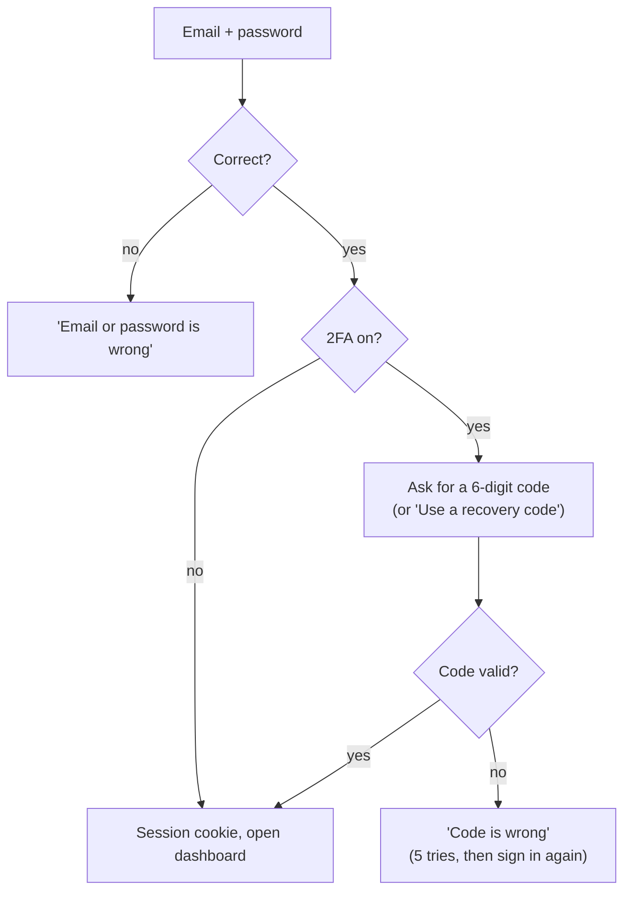

# Owner sign-in plan: email and password, optional 2FA

How café owners get an account (the Restrovia team creates it), sign in to the owner portal at
`app.restrovia.shop`, and turn on two-factor authentication if they want it. It replaces the
phone-OTP sign-in in [PLAN.md](PLAN.md) sections 3.6, 4.5 and 6; update those sections when this
ships.

- **Accounts:** created by a Restrovia admin from the store in the admin panel; there is no public
  sign-up. The admin either sets the first password and tells the owner, or emails an invite. An
  owner on a password the admin set must choose their own at the first sign-in.
- **Sign-in:** email and password.
- **2FA:** optional, set up by the owner in Account → Security. It uses an authenticator app (Google
  Authenticator, Microsoft Authenticator, Authy) and comes with one-time recovery codes.
- **Estimate:** about 2 weeks: 1 week for the API, 1 week for the portal screens.

## 1. What already exists and is reused

| Piece | Where | Reused for |
| --- | --- | --- |
| argon2id password hashing, AES-GCM encryption, SHA-256 token hashing, random tokens | `apps/api/src/crypto/crypto.service.ts` | Owner passwords, encrypted TOTP secrets, session and email-link tokens |
| TOTP (RFC 6238) with one step of clock drift and no reuse of a code | `apps/api/src/admin/totp.ts` | Owner 2FA. Move the file to `apps/api/src/crypto/totp.ts` and give `otpauthUrl` the issuer `Restrovia` for owners |
| Admin sign-in flow: equal time for unknown emails, encrypted short-lived setup token, `totp_last_step` | `apps/api/src/admin/admin-auth.service.ts` | Same pattern for the owner password step and the 2FA step |
| Session cookie, CSRF header, cookie reader | `apps/api/src/admin/admin.guard.ts` | `OwnerGuard` with its own cookie and header |
| Per-route `@Throttle` limits | `@nestjs/throttler` in `app.module.ts` | Sign-in, set-password, password reset and 2FA routes |
| QR code for the authenticator | `qrcode` in `apps/admin`, used by the admin sign-in page | Same component in `apps/owner` |
| Owner tables | `apps/api/src/db/schema/owners.ts` | `owners`, `owner_sessions`, `store_members`, `pairing_codes`, `owner_invites` |
| Pairing codes shown on the POS | `apps/api/src/pos/pairing.service.ts` | Linking a store after sign-in |

Nothing new needs installing in the API. Email goes out through the provider's HTTPS API with
`fetch` (see section 5).

## 2. Database changes (one migration)

No code creates `owners` rows yet (only the tables exist), so the migration changes the table
directly. Before running it in production, confirm with `select count(*) from owners` that it is
still empty.

### `owners`

| Change | Why |
| --- | --- |
| `email` becomes `not null` (it stays `citext` and unique) | Email is how owners sign in |
| `password_hash` becomes `not null` | Every owner has a password |
| `phone_e164` becomes nullable and stays unique | Kept as an optional contact number for WhatsApp alerts later |
| Add `totp_secret_enc bytea` | Encrypted authenticator secret; null means 2FA is off |
| Add `totp_last_step bigint` | Last accepted code step, so a code can't be used twice |
| Add `totp_enabled_at timestamptz` | Shown on the security screen |
| Add `password_changed_at timestamptz` | Sessions created before it stop working |
| Add `failed_logins smallint not null default 0` and `locked_until timestamptz` | Per-account lockout (section 4) |

### New `owner_recovery_codes`

| Column | Type | Notes |
| --- | --- | --- |
| `id` | uuid PK | |
| `owner_id` | uuid FK → owners, cascade | |
| `code_hash` | bytea | SHA-256 of the code |
| `used_at` | timestamptz | Each code works once |
| `created_at` | timestamptz | |

Index on `owner_id`. Ten codes are created when 2FA is turned on, and the old ones are deleted when
the owner makes a new set.

### New `owner_email_tokens`

Links sent by email: the invite, a password reset, or a change of email.

| Column | Type | Notes |
| --- | --- | --- |
| `id` | uuid PK | |
| `owner_id` | uuid FK → owners, cascade | |
| `purpose` | text | `invite`, `reset_password` or `change_email` (check constraint) |
| `email` | citext | The address the link was sent to |
| `token_hash` | bytea UQ | SHA-256 of the token in the link |
| `expires_at` | timestamptz | 7 days for `invite`, 30 minutes for `reset_password`, 24 hours for `change_email` |
| `used_at`, `created_at` | timestamptz | |

### Other tables

- `owner_invites`: add `email citext not null`, make `phone_e164` nullable. Managers are invited by
  email.
- `otp_codes`: no longer used for sign-in. Leave it for a later phone-OTP or WhatsApp option, or drop
  it in this migration. Recommended: drop it, because nothing reads it.
- `packages/shared/src/constants.ts`: add `OWNER_EMAIL_TOKEN_PURPOSES`; drop `OTP_PURPOSES` if
  `otp_codes` goes.
- `owners`: `password_hash` is null until the invite is accepted; `created_by_admin_id` records who
  created the account.
- Retention job: delete used or expired `owner_email_tokens` after 7 days, and revoked or expired
  `owner_sessions` after 30 days.

## 3. Flows

### 3.1 Account created by Restrovia

1. A Restrovia admin (super admin, sales or support) opens the store in the admin panel and clicks
   **Create owner account**. The form is filled in from the store's contact details sent by the
   POS; the admin checks the email with the owner.
2. `POST admin/stores/:id/owners {name, email, phone?, password?}` creates the owner, links them to
   the store as `owner` and writes `owner.create` to the audit log.
3. **With a password** (the admin panel's default, with a Generate button): the account gets
   `must_change_password`, the admin passes the email and password on by phone or in person, and
   the owner gets an "account ready" email without the password. After signing in, the portal shows
   only "Choose your own password"; the API refuses every other owner route with
   `password_change_required` until `POST me/password` sets a different one.
4. **Without a password:** the owner is emailed an invite. The link opens `/set-password?token=…`
   (7 days, single use); `POST auth/set-password` saves the password, confirms the email and signs
   the owner in. Until then sign-in answers like a wrong password. The admin can **Resend invite**
   (older links stop working), and "Forgot password" also works for an invited owner.
5. **Set new password** (super admin and support) on the owner page: `POST admin/owners/:id/password`
   sets a password the admin chose, signs out every session, cancels emailed invite and reset links,
   lifts a lockout, sets `must_change_password`, keeps 2FA as it is, and emails the owner.

If the email already has an account (an owner with a second café), the store is added to that
account and the owner gets a "store added" email; an owner who never accepted gets a fresh invite.
Support can remove a person from a store (super admin and support only).

### 3.2 Sign in

- Step 1, `POST auth/login {email, password}`:
  - Wrong email or wrong password give the same error and take the same time, using the dummy-hash
    trick from the admin sign-in.
  - Without 2FA it sets the session cookie and returns `{status: "ok", owner}`.
  - With 2FA it returns `{status: "2fa_required", challenge_token}`. The challenge token is
    encrypted with `CryptoService.encrypt`, holds the owner id, the time it was issued and an
    attempt count, and lasts 5 minutes. No session exists yet.
- Step 2, `POST auth/2fa {challenge_token, code}` or `{challenge_token, recovery_code}`:
  - A valid authenticator code (not reused: `step > totp_last_step`) or an unused recovery code
    creates the session.
  - Using a recovery code marks it used and sends an email: "A recovery code was used to sign in.
    You have N left."
  - After 5 wrong codes on one challenge the owner has to start again from the password step. These
    failures also count towards the account lockout.

### 3.3 Sessions

- Cookie `rv_owner`: HttpOnly, Secure, `SameSite=Lax`, `Path=/api/owner`, host-only on
  `app.restrovia.shop`, valid for 30 days.
- `owner_sessions` gains nothing new. `last_used_at` is updated at most once an hour, and a session
  idle for 30 days stops working.
- Every non-GET request needs the `x-restrovia-owner: 1` header, as the admin panel does.
- A session stops working when it is revoked, expires, was created before `password_changed_at`, or
  the owner is `disabled`.
- Account → Security lists active sessions (device from the user agent, IP, last used) with "Sign
  out" for each and "Sign out everywhere else".

### 3.4 Turning on 2FA

1. Account → Security → "Turn on two-factor authentication". The owner enters their password again.
2. `POST me/2fa/setup {password}` returns a secret, an `otpauth://` link and a setup token
   (encrypted, 10 minutes), the same as admin setup. The portal shows a QR code and the secret as
   text for manual entry.
3. The owner types a code from the app. `POST me/2fa/enable {setup_token, code}` saves the encrypted
   secret, creates 10 recovery codes and returns them once.
4. The portal shows the codes with Copy and Download (`restrovia-recovery-codes.txt`) and won't
   continue until the owner ticks "I saved these codes".
5. Other sessions are signed out, and an email confirms "Two-factor authentication is on".

### 3.5 Turning off 2FA and new recovery codes

- **Turn off:** `POST me/2fa/disable {password, code}` needs the password plus an authenticator
  code or a recovery code. It clears the secret and the recovery codes, signs out other sessions and
  sends an email.
- **New recovery codes:** `POST me/2fa/recovery-codes {password, code}` replaces all ten.
- The security screen shows how many unused recovery codes are left and warns when fewer than 3
  remain.

### 3.6 Forgot password

1. `/forgot-password`, `POST auth/password/forgot {email}`. The answer is always "If that email has
   an account, we sent a link". Limited to 3 per email per hour and 10 per IP per hour.
2. The emailed link opens `/reset-password?token=…`. `POST auth/password/reset {token, password}`
   sets the new password and `password_changed_at`, which signs out every session, marks the email
   verified (the owner proved they can read it) and sends a "Your password was changed" email.
3. **A reset does not turn off 2FA.** The owner then signs in with the new password and still needs
   their authenticator or a recovery code.

### 3.7 Lost authenticator and no recovery codes

The owner contacts support. In the admin panel, Owners → owner → "Reset 2FA" is limited to the
`super_admin` and `support` roles and asks for a reason. It clears the secret and recovery codes,
signs out all the owner's sessions, writes `owner.2fa_reset` to the audit log and emails the owner.
Support confirms identity first. Suggested checks: the store code and the GSTIN or phone number
saved on the POS, and a callback to the phone on the store record.

### 3.8 Change password and change email

- **Change password**, `POST me/password {current_password, new_password}` (plus a code if 2FA is
  on): sets `password_changed_at`, keeps the current session and signs out the others.
- **Change email**, `POST me/email {password, new_email}`: sends a verification link to the new
  address and a notice to the old one. The address changes only when the new link is opened.

## 4. Rules

| Rule | Value |
| --- | --- |
| Password length | 8 to 128 characters; no other composition rules |
| Password must not be | equal to the email, or in a bundled list of the 10,000 most common passwords (a text file in the repo, no network call) |
| Sign-in rate limit per IP | 10 tries in 15 minutes (`@Throttle`, same as admin) |
| Account lockout | After 10 wrong passwords or 2FA codes in a row, the account is locked for 15 minutes and an email is sent; success resets the counter |
| Email links | Single use; stored only as SHA-256 hashes |
| TOTP secrets | Stored encrypted (AES-GCM through `CryptoService`), never logged |
| Recovery codes | 10 codes as `xxxx-xxxx` from an alphabet without look-alike characters, stored as SHA-256, shown once |
| Error messages | Never say whether an email has an account |
| Logs | Never log passwords, codes, tokens or the full email in request logs |

Owner security events (`owner.login`, `owner.login_failed`, `owner.2fa_enabled`,
`owner.2fa_disabled`, `owner.recovery_code_used`, `owner.password_changed`, `owner.locked`) are
written to a new `owner_security_events` table (owner id, action, IP, user agent, time). Account →
Security lists the last 20 so owners can spot sign-ins they didn't make.

## 5. Sending email

The API needs an `EmailService` with one method, `send({to, subject, text, html})`, called with
`fetch` against the provider's HTTPS API, so no SDK is added.

- **Provider:** Resend (free up to 3,000 a month) is built: `EMAIL_PROVIDER=resend`. Amazon SES in
  Mumbai is cheaper at volume but needs AWS request signing; it is not built.
- **DNS on `restrovia.shop`:** SPF, DKIM and DMARC records for the sender `no-reply@restrovia.shop`.
  Receiving mail is separate: `support@restrovia.shop` needs inbound mail such as Cloudflare Email
  Routing.
- **Environment:** `EMAIL_PROVIDER`, `EMAIL_API_KEY`, `EMAIL_FROM` and `OWNER_APP_URL` (the base of
  the links) in `ops/env.example`. With `EMAIL_PROVIDER=outbox`, the default, emails go to an
  in-memory outbox that tests read; in development the API also prints them to its log.
- **Emails:** invite, account ready (password set by an admin), password set by support, store added, reset password, password changed, confirm new email, 2FA on, 2FA
  off, 2FA reset by support, recovery code used, account locked.
  Plain text plus simple HTML in English.

## 6. Owner API (`/api/owner`)

| Route | Guard | Notes |
| --- | --- | --- |
| `POST auth/login` | CSRF header, throttle | Returns `ok` or `2fa_required` |
| `POST auth/2fa` | CSRF header, throttle | challenge token plus code or recovery code |
| `POST auth/logout` | `OwnerGuard` | Revokes this session |
| `POST auth/set-password` | CSRF header, throttle | Invite token and first password; signs in |
| `POST auth/verify-email` | CSRF header, throttle | Change-email token |
| `POST auth/password/forgot` | CSRF header, throttle | Always answers 200 |
| `POST auth/password/reset` | CSRF header, throttle | token, new password |
| `GET me` | `OwnerGuard` | Profile, `email_verified`, `two_factor_enabled`, recovery codes left |
| `PATCH me` | `OwnerGuard` | name, phone |
| `POST me/password`, `POST me/email` | `OwnerGuard` | Section 3.8 |
| `POST me/2fa/setup`, `POST me/2fa/enable`, `POST me/2fa/disable`, `POST me/2fa/recovery-codes` | `OwnerGuard` | Sections 3.4 and 3.5 |
| `GET me/sessions`, `DELETE me/sessions/:id`, `POST me/sessions/revoke-others` | `OwnerGuard` | |
| `GET me/security-events` | `OwnerGuard` | Last 20 |

Code layout: `apps/api/src/owner/` with `owner.module.ts`, `owner-auth.service.ts`,
`owner-two-factor.service.ts`, `owner.guard.ts`, `owner-auth.controller.ts`, `owner-me.controller.ts`,
and `apps/api/src/email/`. Store linking, dashboard and orders come after this, behind `OwnerGuard`
plus a `StoreMemberGuard`.

Admin API additions, all audited: `GET admin/owners`, `GET admin/owners/:id`,
`POST admin/stores/:id/owners`, `DELETE admin/stores/:id/owners/:ownerId`,
`POST admin/owners/:id/resend-invite`, `POST admin/owners/:id/password`,
`POST admin/owners/:id/reset-2fa`,
`POST admin/owners/:id/disable` and `/enable`.

## 7. Owner portal screens (`apps/owner`)

First, clean up the starter the same way `apps/admin` was cleaned up: remove `@clerk/nextjs`,
`features/{ai-chat,chat,kanban,products,users,react-query-demo}` and the demo routes, and copy the
admin panel's API client and sign-in page structure.

| Screen | Route | Contents |
| --- | --- | --- |
| Set password | `/set-password` | From the invite email: password with a show/hide toggle and a hint, then the dashboard |
| Choose your own password | any dashboard page | Shown instead of the portal while `must_change_password` is set |
| Sign in | `/sign-in` | Email, password, "Forgot password?" |
| 2FA code | `/sign-in/2fa` | 6-digit code input (numeric keyboard, auto-submit), "Use a recovery code" |
| Confirm new email | `/verify-email` | Handles the link from "change email" |
| Forgot / reset password | `/forgot-password`, `/reset-password` | |
| Account → Security | `/dashboard/account/security` | Change password, 2FA on/off, recovery codes left plus "Make new codes", active sessions, recent activity |
| 2FA setup | dialog on the Security page | Password → QR code and secret → enter code → recovery codes with Copy/Download and "I saved these codes" |
| Admin: store page | `apps/admin` → `/dashboard/stores/[id]` | "Create owner account" (set a password or email an invite), Invited badge, "Remove" |
| Admin: Owners | `apps/admin` → `/dashboard/owners` | List and search; owner detail with linked stores, 2FA status, "Set new password", "Resend invite", "Reset 2FA", "Disable account" |

Everything has to work one-handed on a phone: large inputs, `autocomplete="email"`,
`autocomplete="current-password"` and `"new-password"`, and `autocomplete="one-time-code"` with
`inputmode="numeric"` on the code input, so password managers and phones fill the fields.

After the first sign-in the dashboard shows the café the account is linked to, next to a gentle
"Protect your account with 2FA" card that can be dismissed.

## 8. Build order

| Step | Work | Done when |
| --- | --- | --- |
| 1 | Migration (section 2), move `totp.ts` to `crypto/`, `EmailService` with the test outbox | Fresh database and upgrade from the current migration both pass `database.spec.ts` |
| 2 | Sign-up, email verification, sign-in without 2FA, `OwnerGuard`, sessions, logout | API tests: sign up → verify → sign in → `GET me` → logout |
| 3 | 2FA setup, sign-in with 2FA, recovery codes, disable | API tests cover every flow in sections 3.2, 3.4 and 3.5, including code reuse and recovery-code reuse |
| 4 | Forgot/reset password, change password/email, lockout, security events | API tests: reset signs out all sessions and keeps 2FA on; lockout after 10 failures |
| 5 | Portal cleanup and the sign-in screens | Invite, set password, sign in and sign out work on a phone browser against staging |
| 6 | Security page and 2FA setup in the portal; admin Owners screen with "Reset 2FA" | An owner turns 2FA on with Google Authenticator, signs in with it, signs in with a recovery code, and support can reset it |
| 7 | Caddy route for `app.restrovia.shop`, email DNS (SPF, DKIM, DMARC), env values on the server | A real verification email lands in a Gmail inbox, not spam |

After step 7, store linking with the POS pairing code and the dashboard are the next work in the
owner portal.

## 9. Tests

All in `apps/api/test/owner.spec.ts` against a real Postgres, as the existing suites do:

- Unknown email and wrong password return the same error.
- Sign-up with an existing email doesn't create a second account and sends the notice email.
- Unverified owners can't link a store.
- A 2FA code can't be used twice; a code outside ±1 step fails; a recovery code works once.
- The challenge token expires after 5 minutes and after 5 wrong codes.
- A password reset signs out every session and does not turn off 2FA.
- Turning 2FA on or off signs out other sessions.
- Lockout starts after 10 failures and ends after 15 minutes.
- An owner session cookie is refused on `/api/admin`, and an admin cookie on `/api/owner`.
- Non-GET requests without the CSRF header are refused.
- Admin "Reset 2FA" is refused for roles other than `super_admin` and `support` and writes the
  audit log.

## 10. Decisions

| Question | Suggested answer |
| --- | --- |
| Email provider | Amazon SES in Mumbai; Resend if you'd rather not set up AWS |
| Should 2FA ever be required? | Optional for everyone at launch; consider requiring it for owners with more than one outlet later |
| Do managers use the same sign-in? | Yes; they're owners rows with the `manager` role on a store, invited by email |
| Keep phone OTP or WhatsApp sign-in for later? | Not now; phone stays as an optional contact field |
| Remember a device for 30 days so 2FA isn't asked every time? | Not at launch; sessions already last 30 days, so 2FA is asked only at sign-in |
