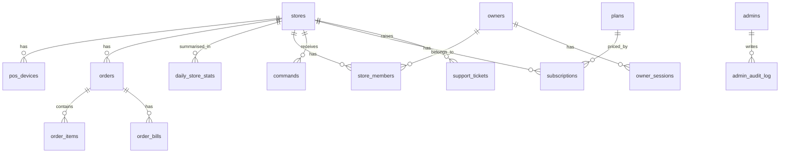

# Restrovia Cloud build plan

The online server that every café's Restrovia POS syncs to, plus the owner portal and the Restrovia
admin panel. Build order: database, then the sync API, then the POS switch, then the portals.

- **Backend:** [NestJS](https://nestjs.com/)
- **Admin panel and owner portal:** based on
  [next-shadcn-dashboard-starter](https://github.com/Kiranism/next-shadcn-dashboard-starter) (MIT)
- **Database:** PostgreSQL with Drizzle ORM
- **Estimate:** about 12 weeks for phases 0–6; online ordering (phase 7) comes later
- **Status:** phases 0 and 1 built (local); not deployed

Phases 0 and 1 are built; see the README for what exists today.

## Contents

1. [Overview](#1-overview)
2. [What the POS already sends](#2-what-the-pos-already-sends)
3. [Database plan](#3-database-plan)
4. [NestJS API](#4-nestjs-api)
5. [Admin panel and owner portal from the starter](#5-admin-panel-and-owner-portal-from-the-starter)
6. [Owner portal screens](#6-owner-portal-screens)
7. [Admin panel screens](#7-admin-panel-screens)
8. [Changes in the POS repo](#8-changes-in-the-pos-repo)
9. [Security checklist](#9-security-checklist)
10. [Hosting and operations](#10-hosting-and-operations)
11. [Testing](#11-testing)
12. [Build phases](#12-build-phases)
13. [Decisions needed](#13-decisions-needed)

## 1. Overview

Each café runs Restrovia POS on its own PC with SQLite and keeps working without internet. When it
is online, the POS sends order changes and answers report requests. Restrovia Cloud stores that
data in PostgreSQL and serves the websites below.

| Address | What it is | Who uses it |
| --- | --- | --- |
| `cloud.restrovia.in` | Sync API the POS talks to (`/api/pos/*`) | POS machines |
| `app.restrovia.in` | Owner portal: sales, live orders, reports, outlets, team | Café owners and managers |
| `admin.restrovia.in` | Admin panel: all stores, licences, support | Your team only |
| `order.restrovia.in` | Online ordering and table booking (phase 7) | Café customers |

### Technology

| Part | Choice | Why |
| --- | --- | --- |
| Language | TypeScript on Node.js 22 | Same as the POS |
| API | NestJS 12 (Express platform, ES modules) | Modules, guards and dependency injection keep a growing API organised |
| Database | PostgreSQL 16 | Reliable; handles JSON snapshots and reports |
| ORM and migrations | Drizzle ORM + drizzle-kit | NestJS documents Drizzle; schema in TypeScript, SQL migrations in git |
| Validation | Zod (via `nestjs-zod`) | The dashboard starter also uses Zod, so API and web share one set of schemas |
| API docs | `@nestjs/swagger` | OpenAPI document for the owner and admin APIs |
| Jobs | `@nestjs/schedule` | Cleanup, daily summaries, deletion requests |
| Rate limits | `@nestjs/throttler` | Register, OTP and login limits |
| Health | `@nestjs/terminus` | `/healthz` for uptime checks |
| Live relay (later) | `@nestjs/websockets` with the `ws` adapter | `/api/pos/relay` |
| Web apps | next-shadcn-dashboard-starter: Next.js 16, React 19, shadcn/ui, Tailwind v4, TanStack Query/Table/Form, Zustand, nuqs, Recharts | Ready-made dashboard layout, tables, charts, forms and role-filtered navigation |
| Hosting | One VPS in Mumbai, Docker Compose, Caddy for HTTPS | About ₹1,500–3,000 a month to start |
| SMS OTP and email | MSG91; Resend or Amazon SES | Indian phone OTP and transactional email |

### Repository layout

```text
restrovia-cloud/                 npm workspaces
├── apps/
│   ├── api/                     NestJS: /api/pos, /api/owner, /api/admin
│   │   └── src/db/              Drizzle schema, migrations, seed
│   ├── admin/                   Admin panel (from the dashboard starter) → admin.restrovia.in
│   └── owner/                   Owner portal (from the dashboard starter) → app.restrovia.in
├── packages/
│   └── shared/                  Zod schemas, API types, constants used by api, admin and owner
├── ops/                         docker-compose.yml, Caddyfile, backup scripts
└── tests/                       POS contract tests
```

Caddy sends `admin.restrovia.in/api/admin/*` and `app.restrovia.in/api/owner/*` to the API container
and everything else to the matching Next.js app. Session cookies are then first-party to each site
and never shared between the two portals.

## 2. What the POS already sends

Read from `main/services/cloud-sync.ts`. The cloud must match it exactly, because installed POS
versions can't be changed after release.

| Call | When | Contents |
| --- | --- | --- |
| `register` | Once; retries with backoff up to 30 minutes | `pos_hash`, `device_secret_hash`, device name, platform, app version, and business details: name, owner name, email, phone, country, currency, timezone, address. Expects `api_key`, `pos_id`, `store_id` back |
| `events` | Every 15 s, up to 50 per batch | `{pos_hash, events: [{id, type, entity_type, entity_id, payload}], sent_at}`; types `order.created`, `order.updated`, `order.status` |
| `heartbeat` | Every 5 minutes | App version, active orders, today's sales and bill count. The response may carry `features` flags |
| `commands` | Every 10 s (or over the WebSocket relay) | Fetches up to 5 commands, runs them, POSTs `{version, correlation_id, ok, result or error, completed_at}` |

Facts that shape the design:

1. **The `api_key` is the HMAC signing secret**, so the cloud must be able to read it. Store it
   encrypted, not only hashed.
2. **Order snapshots have customer data, addresses, notes and `payment_details` removed.** The cloud
   never sees customer names or the cash/UPI/card split. Payment reports come from the live
   `report.payments` command.
3. **The heartbeat's "today" is a UTC day**, which in India starts at 5:30 am. Portal totals come
   from the cloud's own per-day table, worked out in the store's timezone.
4. **A failed batch is resent**, so every event must be ignored if it was already received.
5. **Cloud sync is on by default in the POS**, so once the URL points at a live server, every
   updated install registers by itself.

## 3. Database plan

Build this first: 26 tables in 6 groups, with phase 7 tables listed in the phases section. IDs are
UUIDs unless stated; times are `timestamptz` stored in UTC. In the tables below, **PK** marks the
primary key, **FK** a foreign key and **UQ** a unique column.

### 3.1 Rules for every table

- **Money:** `numeric(14,2)` in the store's currency, never floating point. Quantities use
  `numeric(12,3)` for items sold by weight.
- **One store can never see another:** every synced or business table has a `store_id`, and every
  owner query filters by the stores that owner is a member of.
- **POS ids are only unique inside one store:** synced rows are keyed by `(store_id, pos_*_id)`.
- **Secrets are never stored in plain text:** passwords use argon2id; session tokens and OTP codes
  are stored as SHA-256 hashes; API keys and TOTP secrets are encrypted with AES-256-GCM using a
  master key kept outside the database.
- **Migrations only add.** Never drop or reset customer data. Test every migration on a copy of
  production before release.

### 3.2 How the tables connect



### 3.3 Stores and POS devices

#### `stores`

One row per café or outlet. Its id is the `store_id` returned to the POS.

| Column | Type | Notes |
| --- | --- | --- |
| `id` | uuid PK | Returned to the POS as `store_id` |
| `name` | text | Business name from the POS |
| `contact_name` | text | Owner name from the POS |
| `email` | citext | |
| `phone` | text | |
| `country` | char(2) | e.g. `IN` |
| `currency` | char(3) | e.g. `INR` |
| `timezone` | text | IANA name, e.g. `Asia/Kolkata`; used for business dates |
| `business_day_start` | time | Default `00:00` |
| `address` | text | |
| `store_type` | text | cafe, restaurant, bakery… |
| `status` | text | `active`, `suspended`, `deleted` |
| `created_at`, `updated_at`, `deleted_at` | timestamptz | |

Indexes: `(status)`, `(lower(name))`.

#### `pos_devices`

Each POS install. Its id is the `pos_id` returned to the POS.

| Column | Type | Notes |
| --- | --- | --- |
| `id` | uuid PK | Returned to the POS as `pos_id` |
| `store_id` | uuid FK → stores | |
| `pos_hash` | text UQ | Install identity sent by the POS |
| `api_key_lookup` | bytea UQ | SHA-256 of `api_key`; finds the device from the Bearer header |
| `api_key_enc` | bytea | `api_key` encrypted with AES-256-GCM; needed to check HMAC signatures |
| `device_secret_hash` | text | |
| `device_name`, `platform`, `arch` | text | |
| `app_version`, `run_mode`, `install_source` | text | |
| `last_heartbeat_at` | timestamptz | Online if within 10 minutes |
| `last_ip` | inet | |
| `active_orders`, `today_bills` | integer | From the heartbeat |
| `today_sales` | numeric(14,2) | From the heartbeat (UTC day, display only) |
| `features` | jsonb | `cloud_sync_enabled`, `cloud_orders_enabled`, `cloud_reports_enabled` sent back |
| `diagnostics_consent` | boolean | |
| `revoked_at` | timestamptz | Set to block a device |
| `created_at` | timestamptz | |

Indexes: `(store_id)`, `(last_heartbeat_at)`.

#### `request_nonces`

Stops a captured request from being replayed.

| Column | Type | Notes |
| --- | --- | --- |
| `device_id` | uuid PK, FK → pos_devices | |
| `nonce` | uuid PK | `X-Flo-Nonce` |
| `seen_at` | timestamptz | Deleted after 10 minutes |

### 3.4 Synced sales data

#### `sync_events`

Every event received, so a resent batch is never stored twice.

| Column | Type | Notes |
| --- | --- | --- |
| `device_id` | uuid PK, FK → pos_devices | |
| `event_id` | text PK | Outbox id from the POS |
| `store_id` | uuid FK → stores | |
| `type` | text | `order.created`, `order.updated`, `order.status` |
| `entity_type`, `entity_id` | text | |
| `payload` | jsonb | Cleared after 30 days |
| `received_at` | timestamptz | |

Index: `(store_id, received_at)`.

#### `orders`

Latest state of each POS order, with the key fields as columns for fast reports.

| Column | Type | Notes |
| --- | --- | --- |
| `id` | uuid PK | |
| `store_id` | uuid FK → stores | |
| `device_id` | uuid FK → pos_devices | |
| `pos_order_id` | bigint | Unique together with `store_id` |
| `order_number` | text | |
| `type` | text | `dine_in`, `takeaway`, `delivery`, `online` |
| `online_platform`, `external_order_id` | text | For aggregator orders |
| `status` | text | `pending`, `preparing`, `ready`, `served`, `completed`, `cancelled` |
| `table_name` | text | |
| `guest_count` | integer | |
| `subtotal`, `tax_amount`, `discount_amount` | numeric(14,2) | |
| `packaging_charge`, `delivery_charge`, `service_charge`, `round_off` | numeric(14,2) | |
| `total`, `paid_amount` | numeric(14,2) | |
| `payment_status` | text | From the order's bills |
| `business_date` | date | `created_at` in the store's timezone and business day |
| `pos_created_at`, `pos_updated_at` | timestamptz | An older snapshot never replaces a newer one |
| `completed_at`, `cancelled_at` | timestamptz | |
| `snapshot` | jsonb | Full snapshot as sent (no customer data) |
| `synced_at` | timestamptz | |

Indexes: unique `(store_id, pos_order_id)`, `(store_id, business_date)`, `(store_id, status)` for
open orders, `(store_id, order_number)`.

#### `order_items`

Items of each order, replaced on every update. Used for top-item reports.

| Column | Type | Notes |
| --- | --- | --- |
| `id` | uuid PK | |
| `order_id` | uuid FK → orders | Deleted with the order |
| `store_id` | uuid FK → stores | Copied for fast reports |
| `pos_item_id` | bigint | |
| `product_name`, `product_sku` | text | Name at the time of sale |
| `variant_id` | bigint | |
| `quantity` | numeric(12,3) | |
| `unit_price`, `subtotal`, `tax_amount`, `discount_amount`, `total` | numeric(14,2) | |
| `status` | text | |
| `voided_at` | timestamptz | |
| `business_date` | date | Copied from the order |

Index: `(store_id, business_date)`.

#### `order_bills`

Bills of each order (more than one for split bills).

| Column | Type | Notes |
| --- | --- | --- |
| `id` | uuid PK | |
| `order_id` | uuid FK → orders | Deleted with the order |
| `store_id` | uuid FK → stores | |
| `pos_bill_id` | bigint | |
| `bill_number` | text | |
| `subtotal`, `tax_amount`, `discount_amount`, `total` | numeric(14,2) | |
| `paid_amount`, `balance` | numeric(14,2) | |
| `payment_status` | text | |
| `paid_at` | timestamptz | |
| `split_label` | text | |

#### `daily_store_stats`

One row per store per business day, updated on every order event. The dashboard reads only this.

| Column | Type | Notes |
| --- | --- | --- |
| `store_id` | uuid PK, FK → stores | |
| `business_date` | date PK | |
| `orders_count`, `bills_count`, `cancelled_count` | integer | |
| `gross_sales`, `net_sales`, `tax_total`, `discount_total` | numeric(14,2) | |
| `avg_bill` | numeric(14,2) | |
| `by_type` | jsonb | Sales and count per order type |
| `by_hour` | jsonb | 24 buckets in store time |
| `updated_at` | timestamptz | |

### 3.5 Live commands

#### `commands`

Requests from the portal that the POS answers (live orders, payment report).

| Column | Type | Notes |
| --- | --- | --- |
| `id` | uuid PK | |
| `store_id` | uuid FK → stores | |
| `device_id` | uuid FK → pos_devices | Target POS |
| `type` | text | `health.get`, `orders.live`, `orders.get`, `report.*` |
| `payload` | jsonb | |
| `correlation_id` | text | |
| `status` | text | `queued`, `sent`, `done`, `failed`, `expired` |
| `requested_by` | uuid | Owner or admin |
| `result` | jsonb | |
| `error` | text | |
| `created_at`, `sent_at`, `completed_at`, `expires_at` | timestamptz | Expires 60 s after creation |

Index: `(device_id, status, created_at)`.

### 3.6 Owners and access

#### `owners`

| Column | Type | Notes |
| --- | --- | --- |
| `id` | uuid PK | |
| `name` | text | |
| `phone_e164` | text UQ | `+91…` |
| `email` | citext UQ | Optional |
| `password_hash` | text | argon2id, optional |
| `phone_verified_at`, `email_verified_at` | timestamptz | |
| `status` | text | `active`, `disabled` |
| `last_login_at`, `created_at`, `updated_at` | timestamptz | |

#### `owner_sessions`

| Column | Type | Notes |
| --- | --- | --- |
| `id` | uuid PK | |
| `owner_id` | uuid FK → owners | |
| `token_hash` | bytea UQ | SHA-256 of the cookie token |
| `user_agent` | text | |
| `ip` | inet | |
| `created_at`, `last_used_at`, `expires_at`, `revoked_at` | timestamptz | 30-day expiry |

#### `otp_codes`

| Column | Type | Notes |
| --- | --- | --- |
| `id` | uuid PK | |
| `phone_e164` | text | |
| `purpose` | text | `login`, `verify_phone` |
| `code_hash` | bytea | |
| `attempts` | smallint | Max 5 |
| `ip` | inet | |
| `expires_at`, `consumed_at`, `created_at` | timestamptz | 5-minute expiry |

Index: `(phone_e164, created_at)`.

#### `store_members`

Which owners can see which stores, and in what role.

| Column | Type | Notes |
| --- | --- | --- |
| `store_id` | uuid PK, FK → stores | |
| `owner_id` | uuid PK, FK → owners | |
| `role` | text | `owner`, `manager` |
| `invited_by` | uuid FK → owners | |
| `created_at` | timestamptz | |

#### `pairing_codes`

The code shown on the POS that links an owner to a store.

| Column | Type | Notes |
| --- | --- | --- |
| `id` | uuid PK | |
| `store_id` | uuid FK → stores | |
| `device_id` | uuid FK → pos_devices | |
| `code_hash` | bytea | |
| `expires_at` | timestamptz | 15 minutes |
| `claimed_by` | uuid FK → owners | |
| `claimed_at`, `created_at` | timestamptz | |

#### `owner_invites`

| Column | Type | Notes |
| --- | --- | --- |
| `id` | uuid PK | |
| `store_id` | uuid FK → stores | |
| `phone_e164` | text | |
| `role` | text | `manager` |
| `invited_by` | uuid FK → owners | |
| `token_hash` | bytea UQ | |
| `expires_at`, `accepted_at`, `created_at` | timestamptz | 7-day expiry |

#### `notification_prefs`

| Column | Type | Notes |
| --- | --- | --- |
| `owner_id` | uuid PK, FK → owners | |
| `daily_summary_whatsapp`, `daily_summary_email` | boolean | |
| `offline_alert` | boolean | Store offline more than 1 hour |
| `updated_at` | timestamptz | |

### 3.7 Plans and licences

#### `plans`

| Column | Type | Notes |
| --- | --- | --- |
| `id` | uuid PK | |
| `code` | text UQ | e.g. `outlet_monthly` |
| `name` | text | |
| `price` | numeric(10,2) | |
| `currency` | char(3) | `INR` |
| `interval` | text | `month`, `year` |
| `max_devices` | integer | POS installs per store |
| `features` | jsonb | |
| `is_active` | boolean | |

#### `subscriptions`

Licence status per store. Only one current row per store.

| Column | Type | Notes |
| --- | --- | --- |
| `id` | uuid PK | |
| `store_id` | uuid FK → stores | |
| `plan_id` | uuid FK → plans | |
| `status` | text | `trial`, `active`, `past_due`, `expired`, `suspended`, `cancelled` |
| `trial_ends_at` | timestamptz | |
| `current_period_start`, `current_period_end` | timestamptz | |
| `cancelled_at` | timestamptz | |
| `notes` | text | |
| `created_by_admin` | uuid FK → admins | |
| `created_at`, `updated_at` | timestamptz | |

Unique index: `(store_id)` where `status` is `trial`, `active` or `past_due`.

#### `subscription_payments`

Money received for licences: recorded manually first, Razorpay later.

| Column | Type | Notes |
| --- | --- | --- |
| `id` | uuid PK | |
| `subscription_id` | uuid FK → subscriptions | |
| `amount` | numeric(10,2) | |
| `currency` | char(3) | |
| `method` | text | `manual`, `razorpay` |
| `gateway_ref` | text | |
| `status` | text | `paid`, `refunded` |
| `recorded_by_admin` | uuid FK → admins | |
| `paid_at`, `created_at` | timestamptz | |

### 3.8 Admin and support

#### `admins`

| Column | Type | Notes |
| --- | --- | --- |
| `id` | uuid PK | |
| `name` | text | |
| `email` | citext UQ | |
| `password_hash` | text | argon2id |
| `totp_secret_enc` | bytea | Encrypted 2FA secret |
| `role` | text | `super_admin`, `support`, `sales` |
| `status` | text | |
| `last_login_at`, `created_at` | timestamptz | |

#### `admin_sessions`

| Column | Type | Notes |
| --- | --- | --- |
| `id` | uuid PK | |
| `admin_id` | uuid FK → admins | |
| `token_hash` | bytea UQ | |
| `ip` | inet | |
| `created_at`, `expires_at`, `revoked_at` | timestamptz | 12-hour expiry |

#### `admin_audit_log`

Every admin action. Append-only: the app's database user can't update or delete rows.

| Column | Type | Notes |
| --- | --- | --- |
| `id` | bigserial PK | |
| `admin_id` | uuid FK → admins | |
| `action` | text | e.g. `subscription.extend`, `store.view_orders` |
| `target_type`, `target_id` | text | |
| `details` | jsonb | |
| `ip` | inet | |
| `created_at` | timestamptz | |

#### `support_tickets`

Tickets sent from the POS Help screen.

| Column | Type | Notes |
| --- | --- | --- |
| `id` | uuid PK | |
| `store_id` | uuid FK → stores | |
| `device_id` | uuid FK → pos_devices | |
| `client_ticket_id` | text | Unique per device |
| `support_code` | text UQ | Returned to the POS |
| `category` | text | |
| `message` | text | |
| `context` | jsonb | App version, OS |
| `status` | text | `open`, `in_progress`, `waiting`, `resolved` |
| `assigned_admin_id` | uuid FK → admins | |
| `created_at`, `updated_at`, `resolved_at` | timestamptz | |

#### `support_ticket_notes`

| Column | Type | Notes |
| --- | --- | --- |
| `id` | uuid PK | |
| `ticket_id` | uuid FK → support_tickets | |
| `admin_id` | uuid FK → admins | |
| `body` | text | |
| `created_at` | timestamptz | |

#### `store_diagnostics`

Error reports from the POS, kept 30 days.

| Column | Type | Notes |
| --- | --- | --- |
| `id` | bigserial PK | |
| `store_id` | uuid FK → stores | |
| `device_id` | uuid FK → pos_devices | |
| `event_id` | text | Unique per device |
| `reason_code` | text | |
| `severity` | text | |
| `payload` | jsonb | |
| `occurred_at`, `received_at` | timestamptz | |

#### `data_deletion_requests`

| Column | Type | Notes |
| --- | --- | --- |
| `id` | uuid PK | |
| `store_id` | uuid FK → stores | |
| `status` | text | `pending`, `cancelled`, `completed` |
| `requested_at`, `scheduled_for`, `completed_at` | timestamptz | Data deleted 7 days after the request |

### 3.9 Retention and cleanup jobs

Run by `@nestjs/schedule` in the `jobs` module.

| Data | Kept for | Job |
| --- | --- | --- |
| `request_nonces` | 10 minutes | Every 5 minutes |
| `otp_codes` | 1 day | Hourly |
| `sync_events.payload` | 30 days (the id stays for duplicate checks) | Nightly |
| `commands` | 7 days; queued commands expire after 60 s | Nightly |
| `store_diagnostics` | 30 days | Nightly |
| `orders`, items, bills, stats | While the store is a customer | Removed by a completed deletion request |
| `admin_audit_log` | Permanent | Never deleted |

## 4. NestJS API

### 4.1 Modules

One NestJS app with one module per area. Each module owns its controllers, services and Drizzle
queries.

| Module | Contains |
| --- | --- |
| `DatabaseModule` | Drizzle client provider (`node-postgres` pool), transaction helper |
| `CryptoModule` | AES-256-GCM encrypt/decrypt, argon2id, SHA-256 token hashing, TOTP |
| `PosAuthModule` | `PosSignatureGuard` (section 4.3) and the nonce store |
| `PosSyncModule` | `/api/pos` controllers: register, heartbeat, events, commands, connection-test |
| `PosPairingModule` | `/api/pos/pairing-code`, `/api/pos/devices` |
| `IngestModule` | Event processing: order upsert, items and bills replace, daily stats |
| `CommandsModule` | Creating commands for the portals and waiting for POS results |
| `OwnerAuthModule` | OTP send/verify, password login, sessions, `OwnerSessionGuard` |
| `OwnerPortalModule` | `/api/owner` controllers: stores, dashboard, orders, reports, live, team |
| `AdminAuthModule` | Password + TOTP login, sessions, `AdminSessionGuard`, `RolesGuard` |
| `AdminModule` | `/api/admin` controllers: overview, stores, licences, owners, admins, audit |
| `BillingModule` | Plans, subscriptions, manual payments; turns POS features off when a licence expires |
| `SupportModule` | Support tickets and notes, `/api/pos/support-ticket` |
| `DiagnosticsModule` | `/api/pos/diagnostics/v2`, `/api/pos/diagnostics-consent` |
| `NotificationsModule` | SMS (MSG91), email, daily summaries, store-offline alerts |
| `JobsModule` | Scheduled cleanup and deletion jobs (`@nestjs/schedule`) |
| `HealthModule` | `/healthz` (`@nestjs/terminus`) |
| `RelayModule` (later) | WebSocket gateway for `/api/pos/relay` |

### 4.2 App setup

- `NestFactory.create(AppModule, { rawBody: true })` so `req.rawBody` is available. The POS signature
  covers the exact body bytes, so hashing must use the raw body, not re-serialised JSON.
- Global `ZodValidationPipe` (`nestjs-zod`) with schemas from `packages/shared`.
- `ThrottlerModule` with named limits: `register` 10 per hour per IP, `otp-send` 3 per 15 minutes per
  number, `login` 10 per 15 minutes per IP.
- Body size limit of 1 MB on `/api/pos/events`.
- `@nestjs/swagger` serves the OpenAPI document for `/api/owner` and `/api/admin` on staging only.
- Global exception filter that returns `{error, code}` and never leaks stack traces.

### 4.3 Checking the POS signature (`PosSignatureGuard`)

Headers sent by the POS:

```text
Authorization: Bearer <api_key>
X-Flo-POS-Hash, X-Flo-Timestamp (ISO), X-Flo-Nonce (UUID)
X-Flo-Body-SHA256, X-Flo-Signature: sha256=<hex>
```

1. Find the device where `api_key_lookup = sha256(api_key)`; reject if it is missing or revoked.
2. `X-Flo-POS-Hash` must equal the device's `pos_hash`.
3. The timestamp must be within ±5 minutes of server time.
4. `sha256(req.rawBody)` must equal `X-Flo-Body-SHA256`.
5. `base = METHOD + "\n" + path_with_query + "\n" + timestamp + "\n" + nonce + "\n" + body_hash`;
   `expected = HMAC-SHA256(decrypt(api_key_enc), base)`; compare with `crypto.timingSafeEqual`.
6. Insert `(device_id, nonce)` into `request_nonces`; reject if it already exists.
7. Attach the device and store to the request for the controller.

Answer `401` for a bad signature and `410` for a revoked device.

### 4.4 POS endpoints (`/api/pos`)

| Endpoint | Server does | Phase |
| --- | --- | --- |
| `POST /register` | If this `pos_hash` was seen before, return its existing ids and key. Otherwise create `stores`, `pos_devices`, a 30-day trial `subscriptions` row, and a random 32-byte `api_key` | 2 |
| `POST /heartbeat` | Update `last_heartbeat_at`, version and counters; return `{features}`. Features are off when the licence has expired | 2 |
| `POST /events` | In one transaction: insert into `sync_events` (skip ids already seen); for new order events upsert the order, replace its items and bills, recompute `daily_store_stats` for that day. Return 200 only after commit, because the POS marks the whole batch delivered on any 2xx | 2 |
| `GET /commands?limit=5` | Return queued, unexpired commands for this device and mark them `sent` | 2 |
| `POST /commands/:id/result` | Save the result, mark the command `done` or `failed` | 2 |
| `POST /connection-test` | Return `{ok: true}` after the signature check | 2 |
| `POST /pairing-code` | Create a 6-digit code valid for 15 minutes | 2 |
| `GET /devices` | Owner devices linked to this store | 2 |
| `POST /support-ticket` | Insert a ticket (skip if the `client_ticket_id` was already received); return a `support_code` | 5 |
| `POST /diagnostics/v2`, `GET`/`POST /diagnostics-consent` | Store error reports; save the consent flag | 5 |
| `POST /email/verification`, `/email-preferences` | Send a verification email; save preferences | 5 |
| `/cloud-data/delete`, `/cloud-data/deletion-request/cancel` | Create or cancel a deletion request | 5 |
| `/password-reset/*` | Cloud-approved POS owner password reset | Later |
| `WS /relay` | Live command channel instead of 10 s polling | Later |

Endpoints that aren't built yet return a clear "not available" answer, so the POS shows a message
instead of retrying in a loop.

### 4.5 Owner API (`/api/owner`)

Guarded by `OwnerSessionGuard` (HttpOnly, Secure, SameSite=Lax cookie on `app.restrovia.in`).
Routes with `:storeId` also use `StoreMemberGuard`, which checks `store_members`, and managers are
limited to read-only routes.

- `POST auth/otp/send`, `POST auth/otp/verify`, `POST auth/login`, `POST auth/logout`, `GET auth/me`
- `GET stores`, `POST stores/link` (pairing code)
- `GET stores/:storeId/dashboard?date=`
- `GET stores/:storeId/orders`, `GET stores/:storeId/orders/:orderId`
- `GET stores/:storeId/reports/{sales,hourly,items,payments}`
- `GET stores/:storeId/live`: creates a command and waits up to 15 s for the POS. If the store is
  offline it returns the stored data with the last sync time.
- `GET`/`POST`/`DELETE stores/:storeId/team`
- `GET`/`PUT notification-prefs`

### 4.6 Admin API (`/api/admin`)

Guarded by `AdminSessionGuard` (cookie on `admin.restrovia.in`, 12-hour expiry, TOTP required) and
`RolesGuard` with a `@Roles()` decorator. Every write adds an `admin_audit_log` row in the same
transaction.

- `POST auth/login` (email + password + TOTP), `POST auth/logout`, `GET auth/me`
- `GET overview`
- `GET stores`, `GET stores/:id`, `GET stores/:id/orders` (logged as `store.view_orders`)
- `POST stores/:id/subscription` (trial, activate, extend, suspend), `POST stores/:id/payments`
- `GET owners`, `POST owners/:id/disable`, `POST owners/:id/sessions/revoke`, `DELETE owners/:id/stores/:storeId`
- `GET tickets`, `GET tickets/:id`, `POST tickets/:id/notes`, `PATCH tickets/:id`
- `GET admins`, `POST admins`, `POST admins/:id/reset-2fa` (super admin only)
- `GET audit-log`

## 5. Admin panel and owner portal from the starter

Both web apps start from
[Kiranism/next-shadcn-dashboard-starter](https://github.com/Kiranism/next-shadcn-dashboard-starter)
(MIT). It provides Next.js 16, React 19, shadcn/ui, Tailwind CSS v4, TanStack Query, TanStack
Table, TanStack Form with Zod, Zustand, nuqs (filters in the URL), Recharts, kbar (Cmd+K),
role-filtered navigation, and light and dark themes.

### 5.1 Setting up the starter

1. Copy the starter into `apps/admin` at a fixed commit (record the commit hash) and keep its MIT
   license notice. Copy it again into `apps/owner`.
2. Run the starter's cleanup script to remove the demo features: products, kanban, chat, the
   Pokémon React Query demo, and the plan-gated "Exclusive" page.
3. **Remove Clerk.** The starter uses Clerk for sign-in, profiles, organisations and billing.
   Restrovia uses its own NestJS login instead, so customer and admin accounts never leave your
   server:
   - Replace the Clerk middleware with a check that calls `GET /api/admin/auth/me` (or
     `/api/owner/auth/me`) and redirects to sign-in when it returns 401.
   - Replace the Clerk sign-in pages with our own forms (admin: email, password, 6-digit TOTP code;
     owner: phone number, then OTP).
   - Remove the Clerk profile, organisation and billing pages and the `@clerk/*` packages.
4. Sentry: leave the DSN empty at first; turn it on later if you choose to use it.
5. Use npm (the starter prefers Bun but also works with npm), so the whole repo uses one package
   manager.
6. Put the API client and React Query hooks in `src/lib/api/`, using the Zod schemas from
   `packages/shared`.
7. Apply the Restrovia colours and logo through the starter's theme settings.

### 5.2 How the starter's parts are reused

| Starter part | Admin panel | Owner portal |
| --- | --- | --- |
| Overview cards and charts | Platform overview | Sales dashboard |
| Data table (search, filters, pagination via nuqs) | Stores, owners, tickets, audit log | Orders, items report |
| Forms (TanStack Form + Zod) | Licence changes, admin users | Team invites, alert settings |
| Workspace switcher | (not used) | Outlet switcher |
| Role-filtered navigation | Super admin / support / sales menus | Owner vs. manager menus |
| Notifications centre | New tickets, stores offline | Store offline, daily summary |
| Cmd+K (kbar) | Jump to a store or owner | Jump to an order |

The owner portal needs extra mobile work: a bottom navigation bar on phones, cards instead of wide
tables, and larger touch targets.

## 6. Owner portal screens

| Screen | Shows | Data from |
| --- | --- | --- |
| Sign in | Phone number, then a 6-digit OTP; email and password as an option | `owners`, `otp_codes`, `owner_sessions` |
| Link store | Enter the code shown in POS Settings → Cloud | `pairing_codes` → `store_members` |
| Dashboard | Today's sales, orders, average bill, comparison with yesterday, sales by order type, hourly chart, online status and last sync | `daily_store_stats`, `pos_devices` |
| Live orders | Open orders with table, items and amount; refreshes every 20 s | `orders.live` command, falling back to `orders` |
| Orders | Search and filter by date, type and status; open one to see the full bill | `orders`, `order_items`, `order_bills` |
| Reports | Sales by day, week and month; top items; hourly; payment methods; Excel and PDF export | `daily_store_stats`, `order_items`; payments from `report.payments` |
| Outlets | All linked stores with today's sales and status | `store_members`, `daily_store_stats` |
| Team | Invite a manager by phone; managers see reports only | `owner_invites`, `store_members` |
| Account | Profile, alerts (daily summary, store offline), plan and expiry date | `notification_prefs`, `subscriptions` |

## 7. Admin panel screens

| Screen | Shows and does | Roles |
| --- | --- | --- |
| Sign in | Email + password + authenticator-app code (required) | All |
| Overview | Stores total and online now, new installs this month, trial vs. active vs. expired, versions in use | All |
| Stores | Search and filter by city, status, version, last sync | All |
| Store detail | Owner contacts, devices, sync health, recent errors, tickets, licence history. Orders stay hidden until "View orders" is clicked, which is logged | All |
| Licences | Start or extend a trial, activate a plan, record a manual payment, suspend | Super admin, sales |
| Owners | Find an owner, unlink a store, disable a login, end sessions | Super admin, support |
| Support | Tickets from POS machines, notes, assignment, status | Super admin, support |
| Admins and audit log | Add or remove team members, reset 2FA, view every admin action | Super admin |

## 8. Changes in the POS repo

| Change | File | Why |
| --- | --- | --- |
| Set `BRAND_CLOUD_SERVER_URL` to `https://cloud.restrovia.in/` | `shared/restrovia-brand.ts` | Turns sync on |
| Rewrite "FloAdmin" and "RevFlo" in UI text (about 15 English strings, mostly in Settings → Cloud) to "Restrovia Cloud" and "Restrovia owner app" | `shared/restrovia-brand.ts` (`rebrandText`) | The current rebrand doesn't cover these names |
| Decide: register automatically (today's default) or only after the owner turns Cloud on | `main/db.ts` defaults and the settings UI | Privacy and terms; see decisions |
| Optional: add payment-method totals (no customer data) to the order snapshot | `main/services/cloud-sync.ts` | Payment reports even when the café PC is off |
| Optional: send the business-day start time at register and in the heartbeat | `main/services/cloud-sync.ts` | Late-night cafés see sales on the right business date |

To test before release, point a test POS at staging by setting `cloud_server_url` in its `settings`
table. The POS uses that setting before the built-in default.

## 9. Security checklist

- HTTPS only, with HSTS; certificates from Caddy.
- HMAC signature check, ±5-minute clock window, one-time nonces.
- API keys encrypted at rest; the master key lives in an environment file outside git, with a backup
  copy kept offline.
- Rate limits on register, OTP send and verify, and login (`@nestjs/throttler`).
- OTP: 6 digits, valid 5 minutes, 5 tries, at most 3 sends per 15 minutes per number.
- Every owner query is filtered through `store_members`, with a test that tries to read another
  store.
- Admin 2FA required, separate cookie per site, audit log written in the same transaction.
- 1 MB request body limit on `/api/pos/events`.
- The app's database user can't drop tables or change the audit log.
- Dependencies checked with `npm audit` in CI; the starter is pinned to a known commit.
- Terms and privacy pages on restrovia.in updated before launch.

## 10. Hosting and operations

| Item | Plan |
| --- | --- |
| Servers | Production VPS (2 vCPU, 4 GB) in Mumbai; a smaller staging VPS at `staging-cloud.restrovia.in` |
| Containers | `caddy`, `api` (NestJS), `admin` (Next.js), `owner` (Next.js), `postgres`; scheduled jobs run inside `api` |
| Backups | Nightly `pg_dump`, encrypted, copied off the server, kept 30 days; a restore test every month |
| Deploys | GitHub Actions: lint, test, build images, deploy to staging; production deploy is a manual step. Migrations run before the new API starts |
| Monitoring | Uptime check on `/healthz`, error alerts, disk and database size alerts, an alert when event ingest stops |

## 11. Testing

- **Unit and API tests:** Vitest (with SWC for decorators), `@nestjs/testing` and Supertest, against a
  real Postgres test database. NestJS 12 is ES-modules only, and Jest can only load it on Node 24.9+.
- **Signature tests:** a correct request passes; a changed body, old timestamp, reused nonce, wrong
  key or revoked device each fail.
- **Ingest tests:** the same batch sent twice stores nothing twice; an older snapshot arriving late
  never overwrites a newer one; daily totals match the sum of orders.
- **Store isolation test:** owner A requests store B's dashboard, orders and reports and gets 404
  every time.
- **Contract test with the real POS:** run Restrovia POS against staging, place orders, go offline
  for an hour, reconnect, and check that every order arrived and totals match the POS reports.
- **Timezone test:** an order at 1:00 am IST counts on that IST date, not the previous UTC date.
- **Web tests:** Playwright sign-in and dashboard flows for both portals.
- **Load test:** 500 stores each sending a batch every 15 s, without slowing the portals.

## 12. Build phases

### Phase 0: Setup (week 1)

- Decisions in section 13 answered.
- Create the `restrovia-cloud` repo with npm workspaces, lint, tests and CI.
- `nest new apps/api`; copy the dashboard starter into `apps/admin` and `apps/owner`; create
  `packages/shared`.
- Buy the VPS; set DNS for `cloud.`, `app.`, `admin.` and `staging-cloud.`.
- Docker Compose with Caddy, Postgres, and the API answering `/healthz`.

**Done when:** `https://staging-cloud.restrovia.in/healthz` answers over HTTPS.

### Phase 1: Database (weeks 1–2)

- Drizzle schema for every table in section 3, with keys, indexes and checks.
- First migration and a seed script (one plan, one super admin, a sample store with sample orders).
- `CryptoModule` for API keys, passwords, tokens and TOTP secrets.
- Nightly backup and one restore test.
- Cleanup jobs from section 3.9.

**Done when:** a fresh database builds from migrations with one command, and a backup restores into
an empty server.

### Phase 2: Sync API (weeks 2–4)

- `PosSignatureGuard` with full tests.
- Register, heartbeat, events (with daily stats), commands and results, connection-test,
  pairing-code, devices.
- Safe placeholders for the endpoints marked phase 5 and later.
- Contract test with a real POS pointed at staging.

**Done when:** a real POS registers, and its orders, including those made while offline, appear in
Postgres with totals that match the POS reports.

### Phase 3: POS update (week 4)

- Cloud URL, FloAdmin/RevFlo text rebrand, and the opt-in decision (section 8).
- POS lint, build and tests; release a new Restrovia POS version to test cafés first.

**Done when:** an updated test install connects on its own and "Test connection" passes.

### Phase 4: Owner portal (weeks 5–8)

- Starter cleanup and Clerk removal in `apps/owner`; OTP sign-in and sessions.
- Store linking by pairing code, outlet switcher.
- Dashboard, live orders, orders, reports with export, outlets.
- Team invites and the manager role; daily summary and store-offline alerts.
- Mobile layout pass.

**Done when:** an owner signs in on a phone, links a store, and sees the same totals as the POS for
today and last week.

### Phase 5: Admin panel and support (weeks 9–10)

- Starter cleanup and Clerk removal in `apps/admin`; email + password + TOTP sign-in.
- Roles, role-filtered navigation, audit log.
- Overview, stores, store detail, licences with manual payments, owners.
- Support tickets, diagnostics, email verification, data-deletion requests.

**Done when:** your team can find any store, extend its licence, and answer a ticket sent from a
POS, and each action shows in the audit log.

### Phase 6: Pilot and launch (weeks 11–12)

- Run at 1–2 real cafés for a week, comparing cloud and POS totals every day.
- Fix issues, load test, final security review.
- Publish the updated terms and privacy pages; release the POS update to all customers.

**Done when:** a week of pilot data matches the POS exactly, with no lost orders.

### Phase 7: Online ordering and table booking (later, 4–6 weeks)

- The POS sends its menu; customers order and pay (Razorpay) at `order.restrovia.in`.
- New POS commands: create an online order (uses the existing "Online" type and goes to KOT and
  KDS) and reserve a table.
- New tables: `menu_categories`, `menu_items`, `online_orders`, `online_payments`, `reservations`.
- A new `apps/order` Next.js site for customers (not based on the dashboard starter).

## 13. Decisions needed

| Question | Suggested answer |
| --- | --- |
| Can we use `restrovia.in` with the `cloud.`, `app.`, `admin.` and `staging-cloud.` subdomains? | Yes, if you own the domain |
| Which hosting provider? | DigitalOcean or AWS Lightsail in Mumbai |
| Owner sign-in method? | Phone OTP first, email and password as an option |
| Should the POS join the cloud automatically or only when the owner turns it on? | Only when the owner turns it on; safest for privacy |
| Use the dashboard starter for the owner portal too, or only for the admin panel? | Both; it saves several weeks |
| Plans and prices (per outlet, monthly or yearly, trial length)? | 30-day trial, then monthly or yearly per outlet |
| Who is the first super admin (email for the 2FA account)? | You |
